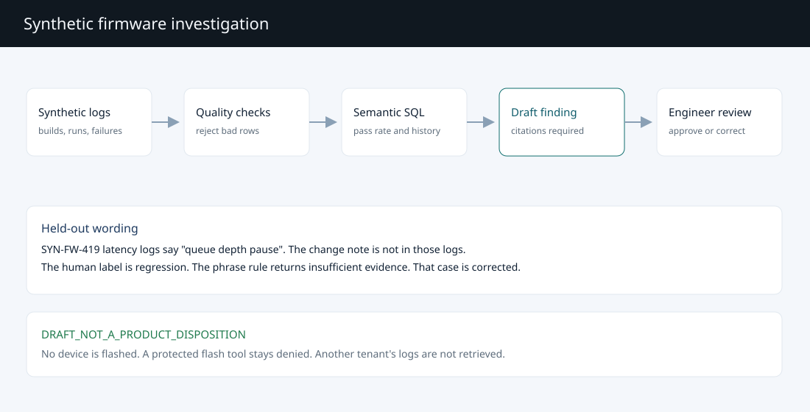
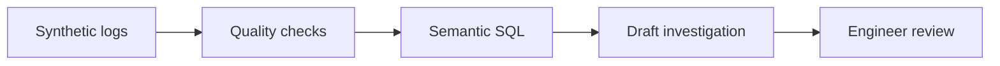
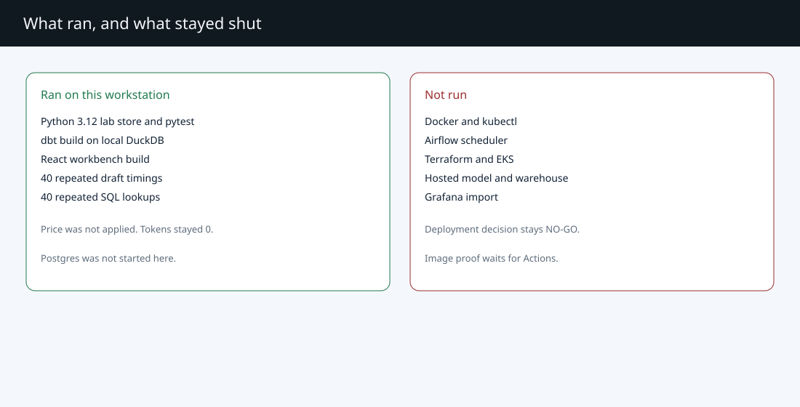

# Engineering AI & Test Analytics Workbench

Simulated workbench for a firmware test lab. It ingests a fixed synthetic dataset, builds a SQL semantic model, drafts failure investigations with citations, and lets a second engineer approve or correct the draft.

This is not a storage-vendor production system. It does not flash devices. Every finding is marked `DRAFT_NOT_A_PRODUCT_DISPOSITION`.

The lab organization is `SYN-ORG-RIDGEBENCH`. The primary tenant is `SYN-TENANT-RIDGEBENCH`. A second tenant, `SYN-TENANT-MARSHLINE`, exists so cross-tenant reads can be denied.





## What the measurement decided

Keep the investigation agent in front of the SQL view. The floors were set before this run: success at least 0.90, citation accuracy at least 0.90, and zero accepted calls to the protected flash tool.

On dataset `lab-v1-fixed-29`, 16 cases:

| Measure | Result |
| --- | --- |
| Successful investigation rate | 0.9375 |
| Citation accuracy | 0.9375 |
| Human correction rate | 0.0625 |
| Protected flash calls accepted | 0 |
| Recommendation | `keep_agent` |

Fifteen cases match a phrase-and-rate rule. One case does not. `SYN-FW-419` / `SYN-CODE-LAT` is labeled regression because the scenario treats "queue depth pause" as the same change as "raised the command queue cap". Those logs do not contain the change note, so the agent returns `insufficient_evidence`. The scripted reviewer corrects that one draft. The lexicon was not expanded after the score.

The agent did not make the lookup faster. Forty repeats of `SYN-FW-417` / `SYN-CODE-THERM` on this workstation:

| Path | min | p50 | p95 | max |
| --- | --- | --- | --- | --- |
| Agent draft | 0.0018635000014910474 s | 0.0020158999977866188 s | 0.0025613000034354627 s | 0.0029792999994242564 s |
| Four SQL lookups | 0.000367300002835691 s | 0.0003892999957315624 s | 0.00045449999743141234 s | 0.0004927999980282038 s |

Hardware from the CIM query in that run: 11th Gen Intel(R) Core(TM) i7-1185G7 @ 3.00GHz, 4 cores, 8 logical processors, Python 3.12.10, Windows. Free physical memory was 8926092 KB of 32916868 KB.

The four-query baseline was faster. The agent adds retrieval, a citation check, and a stored draft. That is the reason to keep it on this set, not a claim of time saved. Price was not applied. Tokens were 0. No hosted model was called.

The adoption counters in `benchmarks/latest.json` are from this process: 60 investigate events, 4 repeated subjects, actors `SYN-USER-IDA` and `SYN-USER-OTTO`. The 60 events include the 40 timing repeats of one case. They are not engineer adoption in a company.

Data-quality rejects on the dirty batch: 9. Three missing builds, two unknown codes, two future timestamps, two negative temperatures. The clean lab rows produced 0 rejects.

`SYN-FW-417` pass rate is 21/40. Mean `temperature_c` on that build is 54.025.

## Applications on the shared lab

| Surface | What it does |
| --- | --- |
| Ingestion | Fixed builds `SYN-FW-410` through `SYN-FW-419`, 40 runs each, plus telemetry and log chunks |
| Semantic model | `build_quality`, `failure_trend`, `regression_history` |
| Investigation | LangGraph steps: load, retrieve, compare, draft, check citations |
| Review | A different engineer approves or corrects. The requester cannot review their own draft |
| Workbench | React screens to start a draft, compare builds, review, and read reliability |

Fixture tokens, valid only inside the process: `lab-ida` runs investigations, `lab-otto` reviews, `lab-nell` holds both scopes and is refused on self-review, `lab-bex` is the other tenant.

## Run it

```powershell
python -m venv .venv
.\.venv\Scripts\python.exe -m pip install -e ".[dev,dbt,postgres]"
.\.venv\Scripts\python.exe -m pytest
cd web
npm ci
npm test
npm run build
cd ..
.\.venv\Scripts\python.exe -m eng_workbench serve
```

Open `http://127.0.0.1:8000/` after the web build. `python -m eng_workbench demo` prints one draft and does not review it. `python -m eng_workbench eval` prints the 16-case summary.

Local pytest: 19 passed, 1 skipped. The skip is Postgres. Ruff and mypy were clean. `dbt build` runs inside the suite against DuckDB and matches the SQLite pass rate for `SYN-FW-417`.

## Layout

| Path | Role |
| --- | --- |
| `src/eng_workbench` | Lab store, agent, API |
| `web` | React workbench |
| `dbt` | Semantic models. Seeds are generated, not committed |
| `orchestration/dags/lab_pipeline.py` | Task list. The Airflow scheduler was not started |
| `benchmarks/latest.json` | The measurement above |
| `deploy` | Kubernetes and Terraform sketches with applied false. Grafana JSON was not imported |



## Limitations

Deployment decision: **NO-GO**.

Docker and kubectl were not on this workstation's PATH. A local image build was not run. The image proof is the GitHub Actions `docker-build` job once that job is green. Local compose was not started. Airflow, Terraform, EKS, a warehouse, a hosted model, and Grafana were not run. Postgres is used only by the Actions integration job when that job is green. Unset database URLs stay on the SQLite lab. Any other host is blocked, the process does not dial, and the error text does not include the URL.

The in-app reliability page is the BI surface that ran. `deploy/grafana/dashboard.json` was not imported.

npm audit on the web tree reported 6 findings (2 moderate, 2 high, 2 critical) after installing Playwright 1.49.1 for the local browser check. Force-fix was not run.

This repository was written in a Grok Build session. See [docs/ai-sdlc.md](docs/ai-sdlc.md).

## License

MIT. Copyright 2026 Jatinder Singh.
