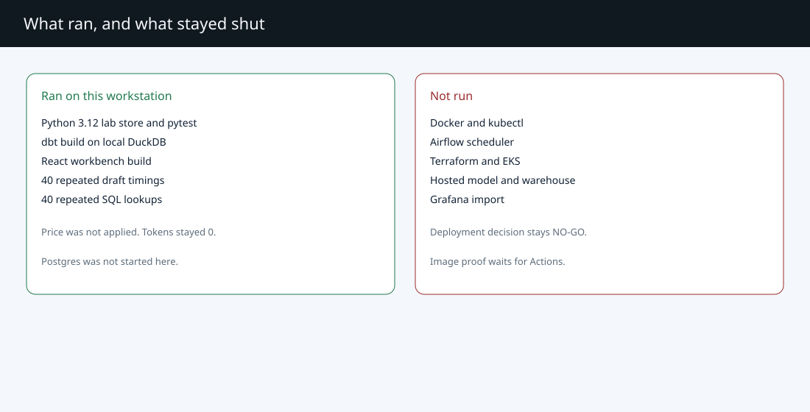

# Deployment

## Decision

NO-GO. The API can serve drafts on localhost. It is not cleared for a shared environment or a factory network.

## Workstation path

This path produced `benchmarks/latest.json` and the local pytest run.

- OS: Windows. Processor: 11th Gen Intel(R) Core(TM) i7-1185G7 @ 3.00GHz. 4 cores. 8 logical processors.
- At the benchmark CIM read, free physical memory was 8926092 KB and total visible memory was 32916868 KB.
- Python 3.12.10 in `.venv`. Node 18.19.1 ran the local web install. CI uses Node 20.
- Store: SQLite `:memory:` with `check_same_thread=False`.
- Commands that ran: `python -m pytest`, `ruff check`, `mypy`, `scripts/benchmark.py`, `npm test`, `npm run build`.
- `dbt build` ran from pytest and wrote `dbt/target/ridge.duckdb`. That directory is gitignored.

Docker and kubectl were not on this workstation's PATH when the repository was assembled. A local image build was not run. `deploy/k8s/workbench.yaml` is marked `applied: false`. `deploy/terraform/main.tf` sets `applied` default false and was not executed. `deploy/grafana/dashboard.json` was not imported.

## Reference environment

The reproducible path is the venv, `pip install -e ".[dev,dbt]"`, pytest, and `python -m eng_workbench serve` after `npm run build`. Compose names an API image and was not started.

## GitHub Actions

`.github/workflows/ci.yml` on `ubuntu-24.04`:

| Job | What it runs |
| --- | --- |
| `test` | `pip install -e ".[dev,dbt]"`, ruff, mypy, pytest, including `dbt build` |
| `integration` | Postgres 16 and `tests/integration/test_postgres.py` |
| `web` | Node 20, `npm ci`, `npm test`, `npm run build` |
| `docker-build` | `docker build` and `docker compose config`. The stack is not started |

`.github/workflows/security.yml` runs `scripts/reject_private_keys.py`. The private-key markers in that file are split so the scanner does not match itself.

The first commit does not list Actions run ids. Those ids belong in a later commit after the jobs finish.

## AWS sketch

`deploy/terraform/main.tf` names an EKS-shaped service in a private network. It was not applied. No cluster, load balancer, or database was created. The Kubernetes file points at `engineering-ai-test-analytics-workbench:ci` and sets `ENG_WORKBENCH_ALLOW_REMOTE=0`.

## Gates

| Variable | Unset | Local host | Other host |
| --- | --- | --- | --- |
| `DATABASE_URL` | SQLite lab | engine may connect | blocked |

`hosted_model`, `airflow_scheduler`, `terraform`, `eks`, and `warehouse` are fixed at `not-run`. `GET /health` reads the gate table and does not dial.
